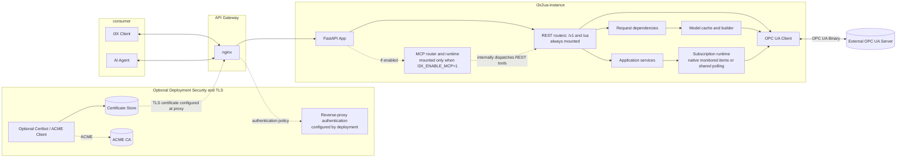
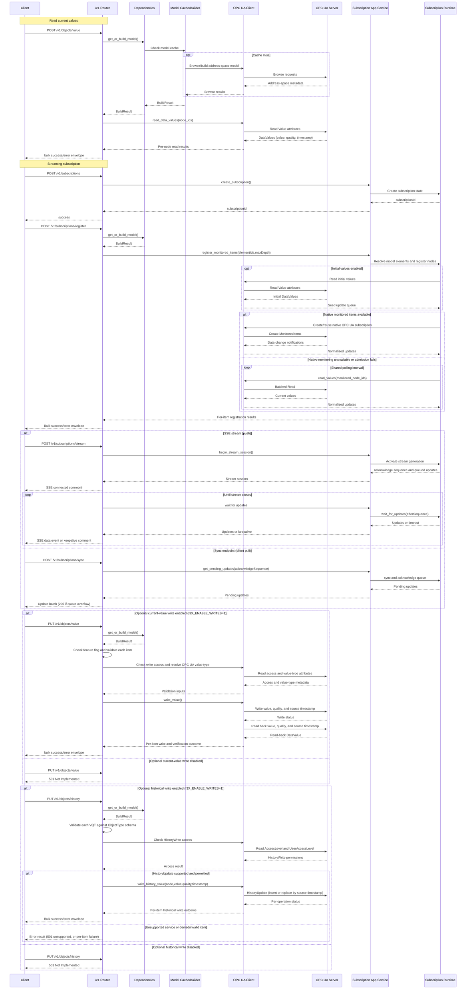

# The i3X API Gateway for OPC UA — REST, MCP & Real-Time Streaming

**FastAPI gateway implementing the i3X API over OPC UA — exposes OPC UA address spaces as standardized REST and MCP endpoints with JSON responses, OpenAPI docs, and Server-Sent Event subscriptions. Built for teams that do not have deep OPC UA expertise.**

[](https://github.com/AndreasHeine/i3x2ua/actions/workflows/docker.yml) [](https://github.com/AndreasHeine/i3x2ua/actions/workflows/quality.yml) [](https://codecov.io/gh/AndreasHeine/i3x2ua)


## **Industrial Information Interoperability eXchange (i3X)**

> The Industrial Information Interoperability Exchange (i3X™) is an open, common API initiative proposed to address a growing interoperability challenge in modern manufacturing architectures: **manufacturing data silo proliferation and API chaos**. As manufacturers adopt heterogeneous software stacks from multiple vendors, the industry risks repeating past fragmentation seen with protocols, platforms, and namespaces - this time at the API layer.


## Architecture Overview



The proxy authentication and certificate-provisioning components are deployment
concerns, not application services. The app does not enforce HTTP authentication;
the Docker Compose example configures Basic Auth at nginx, while Certbot/ACME
provisioning and renewal are handled separately.



## Quick Start

Requirements:

- Python 3.14 to 3.15
- uv
- Optional: running OPC UA server

Install dependencies:

```bash
uv sync
uv sync --group dev
```

Use `uv sync` for runtime dependencies and `uv sync --group dev` when you need linting, typing, and test tooling.

Start API:

```bash
uv run uvicorn i3x_server.main:app --reload --host 127.0.0.1 --port 8000
```

Start without OPC UA server (PowerShell):

```powershell
$env:I3X_SKIP_OPCUA_CONNECT="1"
uv run uvicorn i3x_server.main:app --reload --host 127.0.0.1 --port 8000 --loop none
```

Enable MCP support explicitly when you want the `/mcp` endpoints and MCP tool catalog to be available:

```powershell
$env:I3X_ENABLE_MCP="1"
uv run uvicorn i3x_server.main:app --reload --host 127.0.0.1 --port 8000 --loop none
```

MCP with enhanced Schemas e.g. EnumValues, References, ModelingRules, ...
```powershell
$env:I3X_ENABLE_MCP="1"
$env:I3X_MCP_INCLUDE_OPCUA_METADATA="1"
uv run uvicorn i3x_server.main:app --reload --host 127.0.0.1 --port 8000 --loop none
```

If you do not set `I3X_ENABLE_MCP`, the app starts without MCP support and `/mcp` returns `404`.

Use encrypted OPC UA with the included sample client certificate (development/testing):

```bash
uv run python scripts/generate_opcua_client_cert.py
```

```powershell
$env:I3X_OPCUA_SECURITY_MODE="SignAndEncrypt"
$env:I3X_OPCUA_SECURITY_POLICY="Basic256Sha256"
$env:I3X_OPCUA_CLIENT_CERT_PATH="./certs/opcua-client-sample/client-cert.pem"
$env:I3X_OPCUA_CLIENT_KEY_PATH="./certs/opcua-client-sample/client-key.pem"
uv run uvicorn i3x_server.main:app --reload --host 127.0.0.1 --port 8000 --loop none
```

The OPC UA server may require manually trusting the sample client certificate before the secure session can be established.

If you create your own OPC UA client certificates, ensure they include OPC UA-compatible SAN and key usage fields (application URI, DNS names, clientAuth EKU, and signing/encipherment key usages) and match the server's exposed security mode/policy.

OpenAPI/Swagger:

- http://127.0.0.1:8000/openapi.json
- http://127.0.0.1:8000/docs

Operations are grouped in workflow order: **Exploratory** (address-space
discovery), **Query** (current and historical reads), **Update** (writes), and
**Subscribe** (data-change subscriptions), followed by **Diagnostics** and **MCP**.

The generated document includes request examples, i3X HTTP error envelopes,
subscription SSE wire format, sync overflow (`206`), optional-write failures
(`501`), and conditional-GET headers and bodyless `304` responses. Validation
errors return `400`, not FastAPI's default `422`. Bulk responses can use HTTP
`200` while individual items fail: always inspect each item's `success`,
`error`, and `responseDetail`. Example element and subscription IDs are
placeholders; replace them with IDs returned by discovery or creation.

For production, configure HTTPS and authentication/authorization at the reverse
proxy; keep `/v1/info` public as required by i3X. The application does not enforce
an HTTP authentication scheme, and the OpenAPI document deliberately does not
claim otherwise. Subscription `clientId` is a scope identifier, not a credential.
Diagnostics and MCP are gateway extensions; restrict their exposure according
to your deployment policy. HTTP caching headers are not generated as MCP tool
arguments.

When running the nginx reverse proxy from `docker compose up -d`, use `http://localhost:8080/` for the HTTP entrypoint or `https://localhost:8443/` for the HTTPS entrypoint. `8443` is mapped to nginx's TLS port, so `http://localhost:8443/` will return a 400 error by design.

## API Surface

Active endpoints are exposed under `/v1` for:

- info and metadata (`/info`, `/namespaces`, `/objecttypes`, `/relationshiptypes`)
- filtered type queries (`/objecttypes/query`, `/relationshiptypes/query`)
- object queries and values (`/objects`, `/objects/list`, `/objects/related`, `/objects/value`, `/objects/history`)
- subscriptions (`/subscriptions`, `/subscriptions/register`, `/subscriptions/unregister`, `/subscriptions/sync`, `/subscriptions/list`, `/subscriptions/delete`, `/subscriptions/stream`)

Current scope emphasis: this implementation prioritizes read/query/subscribe operations and includes optional current-value and historical write support.

### OPC UA browse entrypoints

By default, instance discovery starts at the OPC UA **Objects** folder (`ns=0;i=85`).
Set `I3X_OPCUA_BROWSE_ROOTS` to a single URI-based ExpandedNodeId or a JSON array
to discover only the selected objects and their forward hierarchical descendants:

```dotenv
I3X_OPCUA_BROWSE_ROOTS='nsu=urn:example:plant;s=Machine1'
# Or multiple entrypoints:
I3X_OPCUA_BROWSE_ROOTS='["nsu=urn:example:plant;s=Machine1","nsu=urn:example:plant;s=Machine2"]'
```

Configured entrypoints must be readable OPC UA Objects. Numeric (`i=`), string (`s=`),
GUID (`g=`), and base64 byte-string (`b=`) identifiers are supported. Namespace URIs
are resolved against the connected server on every model build; namespace-index IDs
(`ns=2;...`) and remote-server addressing are not accepted.
Configuration is read at startup; restart the gateway after changing it.

Disjoint entrypoints become separate i3X root objects, accessible through
`GET /v1/objects?root=true`. Overlapping entrypoints and shared descendants are
deduplicated, preserving modeled hierarchy/composition relationships. No synthetic
container or Objects folder is added. These are browse entrypoints, not forced API roots.

Empty or malformed configuration is rejected. An unknown namespace, missing node,
unreadable node, or non-Object entrypoint fails the entire model build, without falling
back to Objects or publishing a partial model. A failed periodic refresh retains the
previous model. To fail startup on model-build errors, set both
`I3X_MODEL_PRELOAD_BLOCKING=1` and `I3X_FAIL_STARTUP_ON_MODEL_PRELOAD_ERROR=1`
with `I3X_MODEL_PRELOAD_ON_STARTUP=1`.

With startup preload enabled, `I3X_MODEL_PRELOAD_BLOCKING=1` waits for both the
model build and object-type context warm-up before completing application startup.
With `I3X_MODEL_PRELOAD_BLOCKING=0` (the default), both run in the background;
early model-dependent requests may wait for the model, and type-dependent requests
may also wait for object-type warm-up. Object-type warm-up failures are logged and
retried on demand by requests.

Object-type discovery remains independent and is not restricted to these entrypoints.
This setting scopes discovery, not authorization: forward hierarchical cross-links
can lead into other branches or namespaces.

### Model revisions and conditional GET

Every response built from the address-space model carries `I3X-Model-Revision`, a content hash of the model. It changes only when the model content changes, not on every periodic rebuild. Model-derived `GET` endpoints (`/objects`, `/objecttypes`, `/namespaces`, `/relationshiptypes`, `/model/namespace-gaps`) also return a weak `ETag` and `Cache-Control: no-cache`. Send it back in `If-None-Match` to get `304 Not Modified` with an empty body while the representation is unchanged:

```bash
curl -i https://localhost:8443/v1/objects -H 'If-None-Match: W/"<etag>"'
```

A response served from a stale cache keeps the older ETag, so clients pick up the refreshed data on their next revalidation.

Optional OPC UA diagnostic endpoints are exposed under `/ua`:

- client state and connectivity (`/ua/state`, `/ua/connection`)
- session limits and metrics (`/ua/limits`, `/ua/metrics`)

Optional MCP endpoints are exposed only when `I3X_ENABLE_MCP=1`:

- **MCP Streamable HTTP endpoint**: accepts JSON-RPC requests at `POST /mcp` and returns JSON responses. `GET /mcp` opens a session-scoped SSE stream for server-to-client messages. Initialization returns `Mcp-Session-Id`; clients can close a session with `DELETE /mcp`. Existing POST clients that do not send session headers remain supported.
- **MCP Helpers**: Local REST-style convenience endpoints for the tool catalog and tool calls (`/mcp/tools`, `/mcp/call`), prompt listing/definition/execution, resource listing/reading, and plant roots (`/mcp/roots`). These are not MCP protocol routes.

MCP targets protocol revision `2025-06-18`. It supports `initialize`, `ping`,
`tools/list`, `tools/call`, `prompts/list`, `prompts/get`, `resources/list`,
`resources/read`, and `resources/templates/list` (currently empty). Unsupported
versions negotiate back to `2025-06-18`; subsequent requests may specify
`MCP-Protocol-Version: 2025-06-18`. Explicit unsupported HTTP version headers
are rejected with `400`. JSON-RPC batch arrays are not supported by this revision.
The SSE stream sends `event: message` events and periodic keep-alives. Server
code can publish a JSON-RPC notification to connected clients with
`publish_mcp_notification(app, session_id, method, params)` from
`i3x_server.api.mcp.monolithic`.

For example, initialize and copy the returned session ID into the later
commands:

```bash
curl -i http://127.0.0.1:8000/mcp \
  -H 'Content-Type: application/json' \
  -H 'Accept: application/json, text/event-stream' \
  --data '{"jsonrpc":"2.0","id":1,"method":"initialize","params":{"protocolVersion":"2025-06-18","capabilities":{},"clientInfo":{"name":"curl","version":"1"}}}'

curl -i http://127.0.0.1:8000/mcp \
  -H 'Content-Type: application/json' \
  -H 'Accept: application/json, text/event-stream' \
  -H 'Mcp-Session-Id: <SESSION_ID>' \
  -H 'MCP-Protocol-Version: 2025-06-18' \
  --data '{"jsonrpc":"2.0","id":2,"method":"tools/list"}'

curl -N -i http://127.0.0.1:8000/mcp \
  -H 'Accept: text/event-stream' \
  -H 'Mcp-Session-Id: <SESSION_ID>'

curl -i -X POST http://127.0.0.1:8000/mcp \
  -H 'Content-Type: application/json' \
  -H 'Mcp-Session-Id: <SESSION_ID>' \
  --data '{"jsonrpc":"2.0","method":"notifications/initialized"}'
```

The final command verifies client-to-server notification handling (HTTP 202).
To verify a server-to-client notification, keep the SSE command connected and
call `publish_mcp_notification` from application code for that session.

Tool catalogs include annotations and an `outputSchema`. Calls return legacy JSON
text alongside `structuredContent: {"statusCode": ..., "body": ...}` and `isError`,
including per-item failures. Invalid tool arguments use JSON-RPC `-32602`;
execution failures use tool results. Notifications return `202` with no body.
Standard `prompts/get` accepts string `arguments` and returns rendered `messages`;
custom REST prompt helpers and `prompts/execute` retain their existing formats.

The MCP catalog also includes four read-only, cached-model tools that compose
semantic and relationship context rather than exposing individual REST calls:
`searchModelElements`, `getElementContext`, `summarizeSubtree`, and
`traceRelationshipPath`. They return model element IDs and the current model
revision; subtree and path traversal are bounded by caller-supplied depth and
size limits.
`resolveElementIdsToNodeIds` and `resolveNodeIdsToElementIds` provide batch
identity translation using indexes built with the cached model. They return
per-item results and never establish an OPC UA connection or invoke OPC UA
services.

MCP requests with an `Origin` must match a loopback request origin or an explicit origin
in `I3X_CORS_ALLOWED_ORIGINS` (wildcards do not authorize MCP origins). Configure
the external origin when deploying behind a reverse proxy. Authentication remains
the deployment's responsibility; use HTTPS and an authenticated proxy remotely.

MCP write policy: `PUT` routes are intentionally excluded from MCP tool generation. Object writes are available via REST only.

## Current Limitations

### i3X contract

- Update methods are optional in i3X. This gateway exposes the standard bulk endpoints `PUT /v1/objects/value` and `PUT /v1/objects/history`; historical reads use `POST /v1/objects/history`.
- Current-value updates use a VQT: `value` is required and must conform to the ObjectType schema; optional `quality` defaults to `Good` and optional RFC 3339 `timestamp` defaults to server time.
- Historical updates insert or replace records by source timestamp and require a complete VQT. `Bad` and `GoodNoData` require a null value, and null requires one of those qualities plus schema-declared nullability.
- The implementation validates writes against the target's published ObjectType JSON Schema. Invalid values fail with 400; missing or invalid schemas fail with 502.

### OPC UA gateway integration constraints

- current-value and historical write support is optional and controlled by `I3X_ENABLE_WRITES`:
	- `I3X_ENABLE_WRITES=1`: `capabilities.update.current=true`, `capabilities.update.history=true`, both bulk write endpoints enabled
	- default (`I3X_ENABLE_WRITES` unset/0): write endpoints return `501 Not Implemented`
- Current-value writes send quality and source timestamp as OPC UA `DataValue` fields and verify them with a read-back. If the upstream server does not preserve both, that item returns `501 Not Implemented`; if verification fails, the outcome is reported as uncertain rather than successful.
- Historical writes require upstream `HistoryUpdate` support and per-node OPC UA `HistoryWrite` access. When enabled, `capabilities.update.history` is true until the gateway receives service-wide `BadServiceUnsupported`; it then becomes false. Per-node permission differences remain request-time errors. The standard asyncua 2.1.0 server rejects `HistoryUpdate`.
- This adapter requires historical timestamps in UTC with a `Z` suffix and accepts fractional precision beyond six digits only when the extra digits are zero. The six-digit precision limit is an OPC UA adapter constraint; i3X's RFC 3339 timestamp requirement does not impose that limit.
- The OPC UA mapping supports historical writes for Variable-backed property elements with built-in Boolean, numeric, String, DateTime, Guid, and base64 ByteString values. Arrays must be rectangular and conform to OPC UA ValueRank and ArrayDimensions. Composition fan-out and custom structured values are not supported.
- Writes are validated against the published ObjectType schema, including formats and nullability. External schema references are not downloaded or accepted. Write element IDs must be printable with no surrounding whitespace.
- Historical mutations are not automatically retried after a transport failure. Explicit service-wide `BadServiceUnsupported` returns HTTP 501 unless earlier items succeeded, in which case mixed results retain HTTP 200; after that service-wide result, subsequent history writes return 501 without an upstream attempt. Node-level unsupported operations and permission denials remain item-level failures and do not by themselves disable history updates globally.

## Docker

Quickstart (Docker image):

```bash
docker run -d --name i3x2ua-master -p 8080:8000 -e I3X_ENABLE_MCP=1 -e I3X_OPCUA_ENDPOINT=opc.tcp://opcua.umati.app:4843 ghcr.io/andreasheine/i3x2ua:master
```

Multiline (bash):

```bash
docker run -d \
	--name i3x2ua-master \
	-p 8080:8000 \
	-e I3X_ENABLE_MCP=1 \
	-e I3X_OPCUA_ENDPOINT=opc.tcp://opcua.umati.app:4843 \
	ghcr.io/andreasheine/i3x2ua:master
```

Run with compose:

```bash
docker compose up -d
```

Build your own image with an explicit server version for `/v1/info`:

```bash
docker build --build-arg BUILD_VERSION=1.1.0 -t i3x2ua:1.1.0 .
```

If `BUILD_VERSION` is not set, the API falls back to `master`.

The stack now starts the API behind an nginx reverse proxy. The app container stays internal, while nginx exposes HTTP and optional HTTPS.

The default compose setup also enables container hardening (`read_only`, `tmpfs`, dropped Linux capabilities, `no-new-privileges`).

Optional environment variables:

- `I3X_ENABLE_MCP=1` to enable MCP support; it is disabled by default
- `I3X_ENABLE_WRITES=1` to enable current-value writes (`PUT /v1/objects/value`) and historical writes (`PUT /v1/objects/history`)
- `I3X_OPCUA_CERTS_DIR=./certs` to mount OPC UA client/server certificate files into the app container (`/app/certs`)
- `NGINX_HTTPS_ENABLED=1` to enable TLS termination
- `NGINX_SSL_CERTS_DIR=./certs` with `fullchain.pem` and `privkey.pem`
- `NGINX_BASIC_AUTH_ENABLED=1` with `NGINX_BASIC_AUTH_USER` and `NGINX_BASIC_AUTH_PASSWORD`
- `NGINX_SERVER_NAME` for the public host name

If you enable HTTPS, mount or place the certificate files in the configured cert directory before starting Compose.

If your OPC UA server runs on the Docker host machine, set `I3X_OPCUA_ENDPOINT` to `opc.tcp://host.docker.internal:<port>` instead of `127.0.0.1`.

For local HTTPS testing with the nginx reverse proxy, generate sample certificates:

```bash
uv run python scripts/generate_https_dev_cert.py
```

Then use these environment values:

- `NGINX_HTTPS_ENABLED=1`
- `NGINX_SSL_CERTS_DIR=./certs`
- `NGINX_SSL_CERTIFICATE=/etc/nginx/certs/https-sample/fullchain.pem`
- `NGINX_SSL_CERTIFICATE_KEY=/etc/nginx/certs/https-sample/privkey.pem`

## Development

Before running the commands below, make sure dev tools are installed:

```bash
uv sync --group dev
```

```bash
uv run ruff check .
uv run ruff format .
uv run mypy .
uv run pytest -q
uv run pytest -q --cov=i3x_server --cov-report=term-missing
```

Mypy uses explicit package bases from the repository root so namespace packages
such as `samples` have consistent module names during discovery and imports.

## Production Deployment and i3X Strict Compliance

This application implements the i3X API specification and is designed to run **behind a reverse proxy / api gateway** that is responsible for:

- **TLS termination** — the app itself serves plain HTTP; all HTTPS is handled by nginx.
- **Authentication and authorization** — the app has no built-in auth layer; token validation, basic auth, or mTLS are enforced at the proxy level.

### Required reverse proxy responsibilities for strict i3X compliance

| Requirement | Implementation |
|---|---|
| TLS (HTTPS) for all client-facing traffic | nginx `ssl_certificate` + `ssl_certificate_key` |
| Client authentication (API key / OAuth / mTLS) | nginx `auth_request` or `satisfy any` directives |
| Rate limiting | nginx `limit_req_zone` |
| Access logging | nginx `access_log` |

See the [NGINX configuration reference](docs/NGINX_CONFIGURATION_REFERENCE.md) and [HTTPS guide](docs/PRODUCTION_HTTPS_GUIDE.md) for details.


## License

### Open Source License (AGPL-3.0-or-later)
This project is licensed under the GNU Affero General Public License v3.0 or later.
See the [LICENSE](LICENSE) file for the full legal text.

### Commercial Licensing
**Sponsors at USD 1/month or higher are granted a commercial license while sponsorship remains active, as defined in the sponsor terms.**
**This enables commercial use without AGPL copyleft obligations during active sponsorship.**

[Sponsor @AndreasHeine via GitHub Sponsors](https://github.com/sponsors/AndreasHeine)

See [COMMERCIAL_LICENSE.md](COMMERCIAL_LICENSE.md) for full grant scope, limits, grace period, and verification details.

### Third-Party and Upstream Components
This repository includes third-party and upstream materials with their own licenses, including the bundled `i3X/` subtree.
See [THIRD_PARTY_NOTICES.md](THIRD_PARTY_NOTICES.md) for details.

### Contributions
By contributing to this repository, you agree that your contributions are provided under AGPL-3.0-or-later for the open-source distribution and may be included in commercially licensed distributions of this project.
See [CONTRIBUTING.md](CONTRIBUTING.md) for sign-off requirements and contribution workflow.
