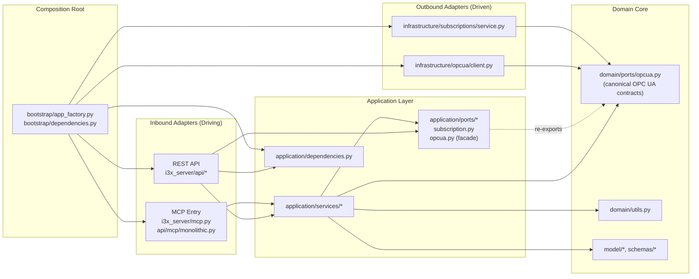

# Architecture Overview

## Purpose

This document defines module ownership and dependency direction for the i3x2ua codebase. It is intended to keep refactor outcomes stable as new features are added.

## Hexagonal Architecture Diagram (Current State)

## Layer Model

The project follows a layered architecture inside i3x_server:

1. presentation
- Responsibility: protocol-facing endpoints, request parsing, response shaping, protocol adapters (REST and MCP).
- Current primary modules: i3x_server/api, i3x_server/mcp.py, i3x_server/api/v1/*_routes.py, i3x_server/api/v1/contracts.py, i3x_server/api/v1/*helpers.py, i3x_server/api/mcp/monolithic.py.

2. application
- Responsibility: use-case orchestration, coordination between services, cross-cutting workflow logic.
- Current primary modules: i3x_server/application/services, i3x_server/application/dependencies.py.

3. domain
- Responsibility: protocol-agnostic rules and reusable core utilities.
- Current primary modules: i3x_server/domain.

4. infrastructure
- Responsibility: external systems and I/O adapters (OPC UA transport, filesystem access, external client concerns).
- Current primary modules: i3x_server/infrastructure/opcua and i3x_server/infrastructure/subscriptions/service.py.

5. bootstrap
- Responsibility: app assembly, startup/shutdown lifecycle, middleware composition.
- Current primary modules: i3x_server/bootstrap.

### Subscription expiry and memory

The subscription cleanup loop checks for inactivity at the configured subscription
interval. Each expiry pass runs in a separate coroutine so references to removed
subscription states, queued updates, and cached values are released when that pass
completes, rather than being retained across sleeps by the background loop.
Shared OPC UA monitors remain until their last subscriber is removed.

Releasing Python objects does not guarantee an immediate reduction in container
memory usage: Python and system allocators may retain freed memory for reuse.

### Model cache ownership

Each `BuildResult` owns its lazily built reverse-parent index. There is no
module-global reverse-parent cache retaining a model after it is replaced.
Once other users release the old model, its nodes and derived index can be
collected without requiring another parent lookup. Parent lookup precedence
and index invalidation based on child-index sizes are unchanged.

Models built by `ModelBuilder` use each node's validated `relationships`
dictionary as the canonical container. The `relationships_by_id` index references
those same dictionaries and target lists rather than retaining duplicate copies.
Similarly, `children_by_id` references each node's validated `children` list,
including empty lists on leaf nodes. Hierarchy and composition child indexes
remain separate because they represent different relationships.
Each node's metadata and `applied_profile_ids_by_id` also share one profile-ID
list per node, without sharing mutable lists between different nodes.
Builder-produced models also share one dictionary between `parent_by_id` and
`hierarchy_parent_by_id`. Composition and fallback parent mappings remain
separate, and manually constructed models can still supply independent indexes.
Consumers should treat these shared model containers as read-only; response
helpers normalize relationships into separate response containers.

### Object-type schema sharing

After object-type schemas are finalized, context construction shares identical
JSON dictionary and list fragments within that context. The temporary lookup
pool is discarded after construction; there is no global schema pool retaining
previous contexts. Sharing preserves dictionary order, list order, and JSON
scalar types.

Cached schemas are read-only. Code that needs to modify a schema for a particular
response must copy it first, as the object-type alias helper already does.
Independent context builds do not share mutable schema containers.

## Dependency Direction

Allowed direction:

presentation -> application -> domain
presentation -> domain (only for thin DTO/helpers when no orchestration is needed)
application -> domain
application -> infrastructure (through stable interfaces or adapter seams)
bootstrap -> presentation/application/infrastructure

Disallowed direction:

- domain importing presentation
- domain importing FastAPI, Starlette, or protocol route modules
- domain importing direct network/framework runtime primitives
- presentation directly orchestrating deep OPC UA workflows when an application service exists

## Ownership Guide

When adding code, prefer the following placement:

- New HTTP endpoint or MCP method handler: presentation (api/*)
- Shared HTTP request/response contracts for v1: presentation-local contracts module (api/v1/contracts.py)
- Shared HTTP-adjacent helper logic for v1: presentation-local helper modules (api/v1/*helpers.py)
- Multi-step business workflow invoked by endpoint: application/services/*
- Pure transformation or rule used by multiple services: domain/*
- External client, filesystem, transport adapter: infrastructure-oriented module (currently opcua/* or dedicated infrastructure package)
- Startup wiring, state initialization, middleware policy: bootstrap/*

## V1 API Structure

The v1 API now follows this split:

- `api/v1/__init__.py`: router aggregation only
- `api/v1/*_routes.py`: feature-specific HTTP handlers
- `api/v1/contracts.py`: shared request/response DTOs and bulk-response helpers
- `api/v1/object_helpers.py`, `api/v1/objecttype_helpers.py`, `api/v1/common_helpers.py`: presentation-local helper logic
- `api/v1/monolithic.py`: compatibility and transitional shims only; no new route ownership

This means orchestration should not move back into `monolithic.py`. New behavior should be added to a feature route module, a helper module, or an application service depending on responsibility.

## Transitional Rules

During migration, compatibility wrappers are expected:

- i3x_server/api/v1/__init__.py is the v1 router aggregator
- i3x_server/api/v1/monolithic.py is retained only as a compatibility surface for remaining direct imports/tests
- i3x_server/api/mcp/__init__.py wraps i3x_server.api.mcp.monolithic exports

For private internals, tests and monkeypatching must target source modules, not wrapper re-exports.

## File Size Guidance

Soft limits:

- Preferred: <= 400 lines per module
- Warning zone: > 600 lines
- Refactor required: > 900 lines unless strongly justified

If a module crosses 600 lines, add a follow-up issue or refactor note with an extraction plan.

## Testing Alignment

Feature tests should live under tests/features/<feature_name>/ and map to runtime ownership:

- API presentation behavior: tests/features/*
- application service behavior: tests/application/* (as introduced)
- infrastructure adapter behavior: tests/infrastructure/* (as introduced)

## Change Safety Checklist

Before merging architecture-affecting work:

1. ruff check and format pass
2. mypy passes
3. pytest passes with coverage gate
4. route behavior parity maintained unless change is explicitly planned
5. imports follow allowed dependency direction
